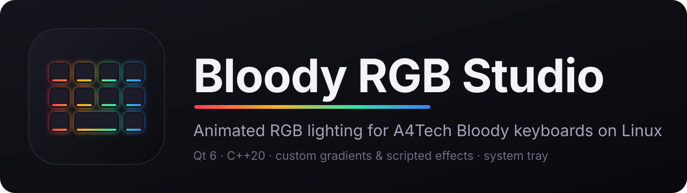
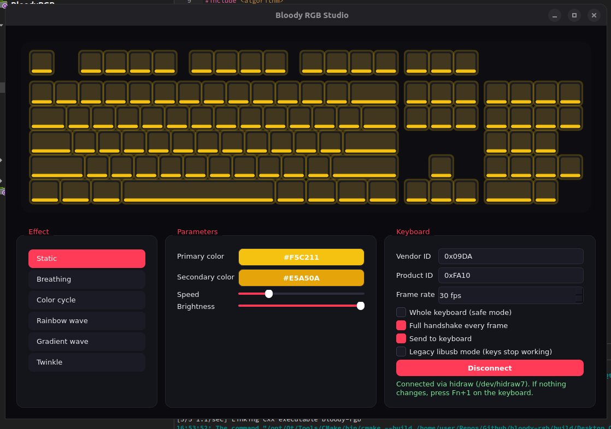

<p align="center">
  
</p>

<p align="center">
  
  
  
  
</p>

**Bloody RGB Studio** is a native Linux app for designing and running RGB backlight animations on
A4Tech Bloody keyboards. It is a Qt 6 / C++20 successor to the Python
[`bloody_keyboard_rgb_control`](https://github.com/apo5tol/bloody_keyboard_rgb_control) script: the same
USB protocol, but with a live keyboard preview, built-in and custom effects, a tray icon and
automatic effect changes when your monitor turns off.

> **Unofficial project.** Not affiliated with or endorsed by A4Tech or Bloody. All trademarks belong to
> their owners. Use at your own risk: the protocol was reverse-engineered, and only the static-color
> commands from the original script are known to be valid.

<p align="center">
  
</p>

## Contents

- [Features](#features)
- [Supported hardware](#supported-hardware)
- [Installation](#installation)
- [Usage](#usage)
- [Custom effects](#custom-effects)
- [When the monitor is off](#when-the-monitor-is-off)
- [System tray](#system-tray)
- [How it works](#how-it-works)
- [Project layout](#project-layout)
- [Troubleshooting](#troubleshooting)
- [Known limitations](#known-limitations)
- [Contributing](#contributing)
- [Acknowledgements](#acknowledgements)

## Features

- **Live preview** of a full-size keyboard with per-key glow, rendered exactly as the effect is sent.
- **Built-in effects:** Static, Breathing, Color cycle, Rainbow wave, Gradient wave, Twinkle.
- **Custom effects**, two kinds:
  - *Gradient animation*: any number of color stops, Wave / Cycle / Ping-pong modes, wave direction.
  - *Script*: write `function color(x, y, t, i)` in JavaScript and return a color per key.
- **Live effect editor** with drag-to-reorder color stops and script error reporting.
- **Monitor-off behavior:** switch to any effect, or turn the lights off, when the display sleeps
  (optionally also when the screen is locked).
- **System tray:** closing the window keeps the app running; switch effects or pause sending from the menu.
- **Keeps your keyboard usable:** talks to the keyboard through `hidraw`, so the kernel driver stays bound
  and typing keeps working while the app runs.
- **Frame-rate control** with a live readout of how many updates per second actually reach the keyboard.
- Speed and brightness sliders, saved settings, dark UI.

## Supported hardware

The defaults match the original project: USB vendor `0x09DA` (A4Tech), product `0xFA10`.

```console
$ lsusb | grep -i 09da
```

If your keyboard shows a different product ID, change **Vendor ID / Product ID** in the *Keyboard*
panel. Other Bloody models may use a different protocol; this has only been developed against the
`09DA:FA10` device. Reports for other models are welcome (see [Contributing](#contributing)).

## Installation

### Dependencies

| Distro | Packages |
| --- | --- |
| Debian / Ubuntu | `sudo apt install build-essential cmake pkg-config qt6-base-dev qt6-declarative-dev libusb-1.0-0-dev` |
| Fedora | `sudo dnf install gcc-c++ cmake pkgconf-pkg-config qt6-qtbase-devel qt6-qtdeclarative-devel libusb1-devel` |
| Arch | `sudo pacman -S base-devel cmake pkgconf qt6-base qt6-declarative libusb` |

Requirements: CMake ≥ 3.21, a C++20 compiler, Qt ≥ 6.2 (Widgets, Qml, DBus), libusb-1.0.

### Build

```console
$ git clone https://github.com/<your-user>/bloody-rgb.git
$ cd bloody-rgb
$ cmake -B build -DCMAKE_BUILD_TYPE=Release
$ cmake --build build -j
```

### Device permissions (udev)

Without a rule the app would need `root`. Install the rule once and re-plug the keyboard:

```console
$ sudo cp packaging/99-bloody.rules /etc/udev/rules.d/
$ sudo udevadm control --reload && sudo udevadm trigger
```

Then run it:

```console
$ ./build/bloody-rgb
```

### Optional: install system-wide

```console
$ sudo cmake --install build
```

This installs the binary, the udev rule, a desktop entry and the icon.

## Usage

1. Put the keyboard into its software-controlled backlight mode. The original project does this with
   <kbd>Fn</kbd> + <kbd>1</kbd>.
2. Start the app and press **Connect**. The keyboard briefly re-initializes (see *Reset device on connect*).
3. Pick an effect on the left, tune color, speed and brightness.

### Keyboard panel options

| Option | What it does |
| --- | --- |
| **Whole keyboard (safe mode)** | Every key gets the same color, which is the only mode matching the verified protocol. Position-based effects (waves, scanners) collapse to a single color. Turn it off for per-key output. |
| **Full handshake every frame** | Sends the 34-packet init sequence before every update (41 packets in total). Slower, but the most faithful to the original script. |
| **Send to keyboard** | Pauses USB traffic while keeping the preview running. |
| **Reset device on connect** | Re-applies the USB configuration before connecting, like `set_configuration()` in the Python tool. The keyboard re-binds for about a second. |
| **Legacy libusb mode** | Uses libusb instead of hidraw. Detaches the kernel driver, so **the keyboard stops typing while connected**. Only for diagnosing problems. |

### Frame rate

Each update is up to 41 USB control transfers, so the keyboard cannot take 30 updates per second.
The *Parameters* panel shows the preview rate and the number of updates per second that actually reach
the keyboard. Static effects send once, and only when the color changes.

## Custom effects

Click **+ New** under the effect list (or double-click a custom effect to edit it). Custom effects are
marked with ★ and stored in `~/.config/bloody-rgb/effects.json`.

### Gradient animation

| Mode | Behavior |
| --- | --- |
| Wave | The gradient loops and moves across the keyboard in the chosen direction. |
| Cycle | The whole keyboard walks through the gradient together. |
| Ping-pong | The whole keyboard fades from the first color to the last and back. |

### Script effects

A script defines one function that is called for **every key, every frame**:

```js
// x, y : key position, 0..1 (left -> right, top -> bottom)
// t    : time in seconds (the Speed slider is already applied)
// i    : key index
// Return [r, g, b] (0-255) or a "#rrggbb" string.
function color(x, y, t, i) {
  var pos = Math.abs(((t * 0.4) % 2) - 1);      // bounces 0 -> 1 -> 0
  var v = Math.max(0, 1 - Math.abs(x - pos) * 6);
  return [255 * v, 20 * v, 40 * v];             // a red bar sweeping left and right
}
```

- Scripts run in Qt's JavaScript engine (QJSEngine), with no access to files or the network.
- Syntax and runtime errors are shown under the editor. A runtime error stops the effect until you edit it.
- A script that never returns (for example `while (true) {}`) will freeze the window.
- Position-based scripts need **Whole keyboard (safe mode)** turned off to show their pattern.

### Fn+ reminder

Each effect can be tagged with *Fn+1 … Fn+9*. This is only a reminder: when you select the effect the app
shows which <kbd>Fn</kbd> combination to press. The app cannot switch the keyboard's slot or detect
which slot is active, because that command is not known.

### File format

```json
{
  "effects": [
    {
      "name": "Ocean",
      "fn": 2,
      "kind": "gradient",
      "stops": ["#00c6ff", "#0072ff", "#00ffa3"],
      "mode": 0,
      "angle": 0,
      "script": ""
    }
  ]
}
```

`kind` is `"gradient"` or `"script"`; `mode` is `0` Wave, `1` Cycle, `2` Ping-pong; `fn` is `0` (none) to `9`.
The file is plain JSON, so effects are easy to share and back up.

## When the monitor is off

Under **When monitor is off** in the *Parameters* panel choose *Keep current effect*, *Lights off*, or any
effect. The keyboard switches when the monitor sleeps and returns to your selected effect when it wakes.
Enable **Also when the screen is locked** if you want a lock screen to count too. **Test (3 s)** previews it.

Detection methods:

| Desktop | Source |
| --- | --- |
| GNOME (Wayland and X11) | `org.gnome.Mutter.DisplayConfig` `PowerSaveMode` over D-Bus |
| Other X11 desktops | DPMS state from `xset q`, polled every 2 seconds |
| Screen lock | `ActiveChanged` on `org.gnome.ScreenSaver` / `org.freedesktop.ScreenSaver` |

KDE Plasma on Wayland has no monitor-state source yet; only the lock option and *Test* work there.
The app must keep running (the tray is fine), because the animation is driven from the PC.

## System tray

Closing the window hides it to the tray. The tray menu has Show/Hide, an effect switcher, a
*Send to keyboard* toggle and Quit. On GNOME you need the
[AppIndicator extension](https://extensions.gnome.org/extension/615/appindicator-support/) for tray
icons; without a tray, closing the window quits the app.

## How it works

**Streaming, not stored profiles.** The only known commands set a static color. Animations are
therefore rendered on the PC and streamed as color frames, so they run only while the app is open.

**Protocol** (ported from the Python project):

- Packets are 64 bytes, sent as a HID *feature report* with report ID `7` to interface `2`
  (`bmRequestType 0x21`, `bRequest 0x09`, `wValue 0x0307`).
- A 34-packet init sequence, then six color packets, then a final packet (`07 05 …`).
- Color packet header: `07 03 06 <id> 00 00`, followed by 58 data bytes. Each channel uses two
  packets (ids `07/08` blue, `09/0a` green, `0b/0c` red), giving **116 LED slots** per channel.
- In whole-keyboard mode every slot gets the same value, which reproduces the original script's packets
  byte for byte. In per-key mode LED index *n* is assumed to be key *n* in row-major order, which is
  unverified.

**Transport.** By default the app writes the packets with `HIDIOCSFEATURE` to the `hidraw` node of
interface 2, which produces the same control transfer without unbinding the kernel driver. The libusb
backend remains as a legacy option.

## Project layout

| Path | Purpose |
| --- | --- |
| `src/Protocol.hpp` | Packet construction (init, color, final) |
| `src/UsbDevice.*` | hidraw and libusb transport |
| `src/Effects.hpp` | Built-in effects, rendered per key |
| `src/UserEffect.*` | Custom effects: storage (JSON), gradient and JavaScript renderer |
| `src/EffectEditor.*` | Effect editor dialog with live preview |
| `src/Layout.hpp` | 104-key layout used by the preview and effects |
| `src/KeyboardView.hpp` | Custom-painted keyboard widget |
| `src/ScreenWatcher.*` | Monitor-off and screen-lock detection |
| `src/MainWindow.*` | Main window, tray, settings |
| `packaging/` | udev rule and desktop entry |
| `assets/` | Logo and banner (SVG + PNG) |

## Troubleshooting

**"Keyboard not found" or "Cannot open /dev/hidrawN".** Install the udev rule, run
`sudo udevadm control --reload && sudo udevadm trigger`, and re-plug the keyboard. Check the IDs with `lsusb`.

**Connected, but the lighting does not change.** Press <kbd>Fn</kbd> + <kbd>1</kbd> on the keyboard first.
Make sure *Send to keyboard* is on, and compare with the original tool: `rgb-control -c ff0000`.

**The keyboard shows a different color than the preview.** Keep *Full handshake every frame* and
*Reset device on connect* enabled, and use *Whole keyboard (safe mode)*. If the original Python tool shows
the correct color but this app does not, please open an issue with the output of `lsusb -v -d 09da:fa10`.

**Keys stop working while connected.** You are in *Legacy libusb mode*. Turn it off.

**Flicker, or fewer updates than the frame-rate setting.** Each update is 41 transfers. Lower the frame
rate and watch the *updates/s* readout.

**No tray icon on GNOME.** Install the AppIndicator extension.

**The window freezes when I run a script effect.** The script probably contains an infinite loop.

## Known limitations

- Animations are streamed from the PC; nothing is stored on the keyboard.
- The Fn+ slot is a reminder only.
- Per-key output is experimental: the LED-to-key mapping is unverified.
- USB writes happen on the UI thread, which can limit smoothness at high frame rates.
- Only Linux is supported, and only the `09DA:FA10` device has been targeted.

## Contributing

Issues and pull requests are welcome. The most valuable contributions are protocol discoveries:

1. Capture USB traffic from the official Windows software (Wireshark with USBPcap).
2. Look for the control transfers to interface 2 (`SET_REPORT`, report ID 7).
3. Open an issue with the capture, or a PR extending `src/Protocol.hpp`, for example the real per-key
   mapping, hardware effects or the profile (Fn slot) switch.

## Acknowledgements

- [`apo5tol/bloody_keyboard_rgb_control`](https://github.com/apo5tol/bloody_keyboard_rgb_control) for the
  original Python implementation and the reverse-engineered packet sequence.
- Qt, libusb and the Linux `hidraw` subsystem.

## License

Add a `LICENSE` file before publishing. The original Python project declares the MIT license, and MIT is
a natural choice here too.
